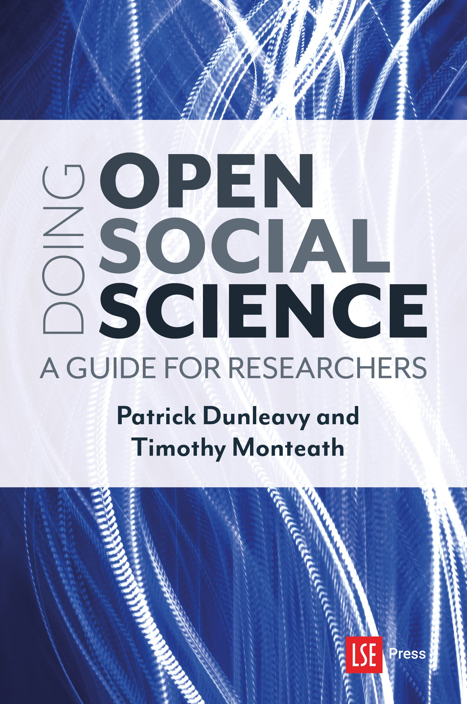
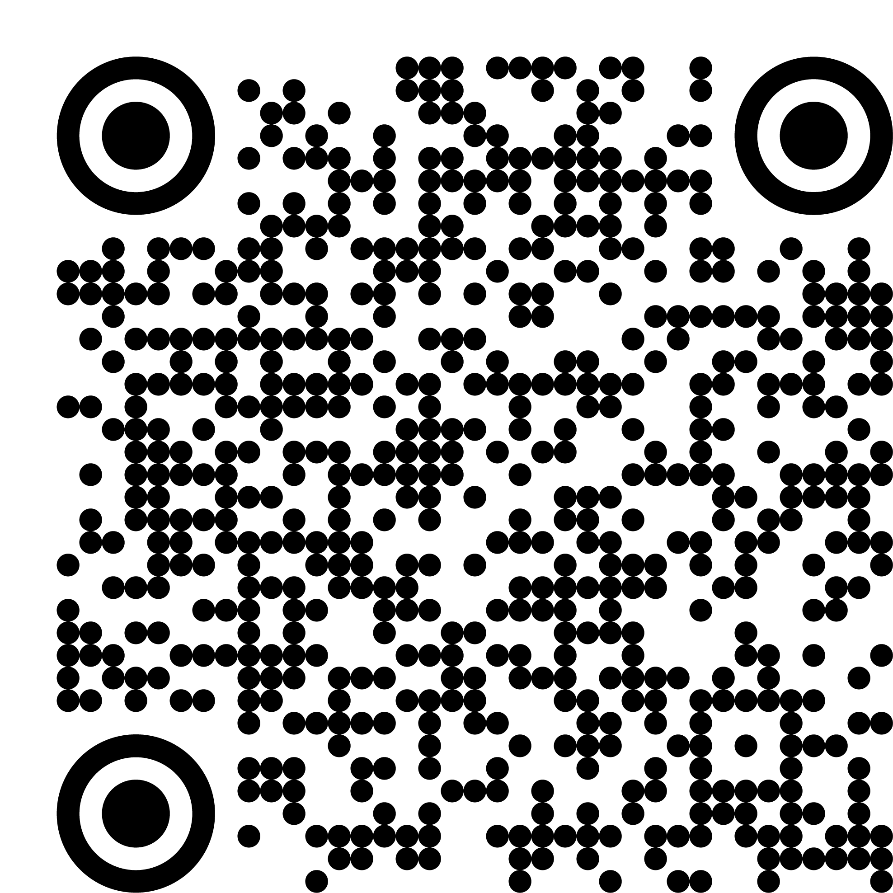
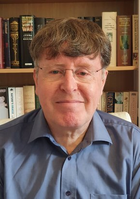
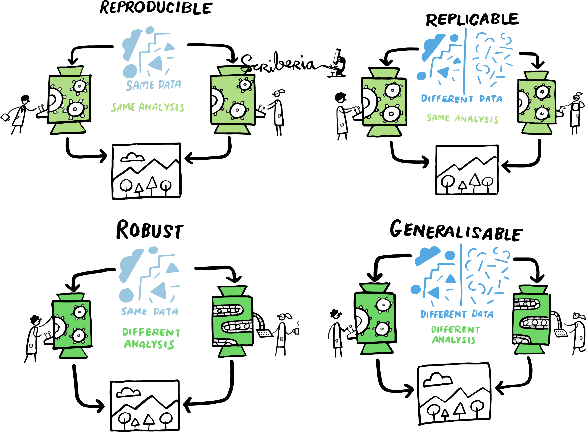
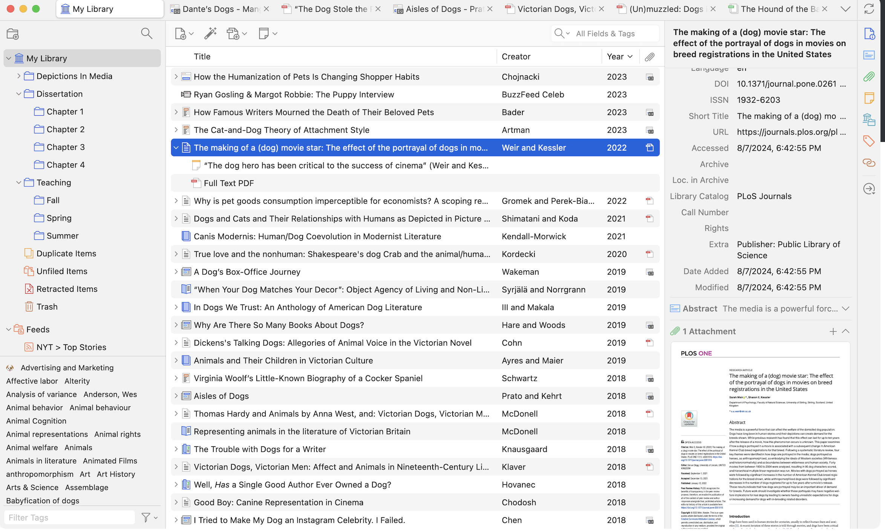
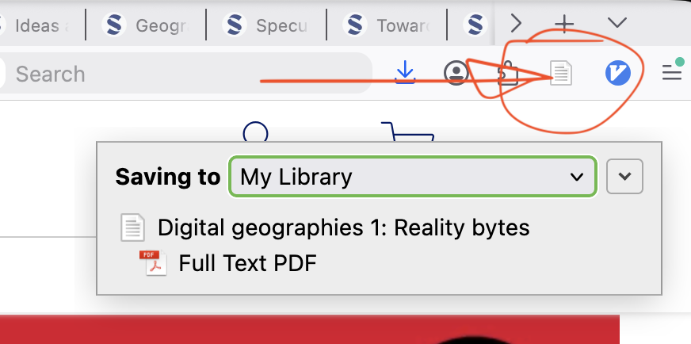
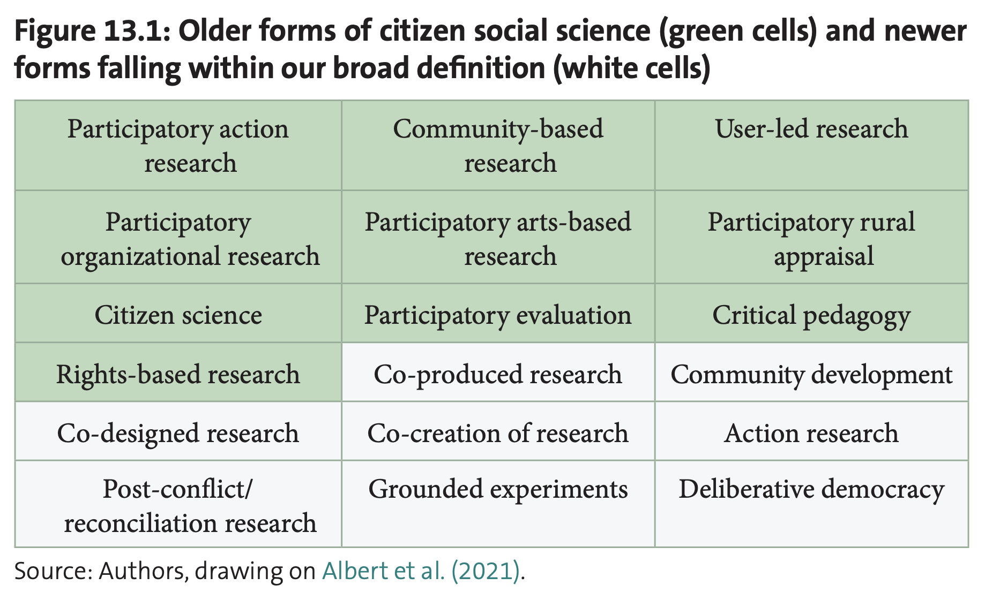
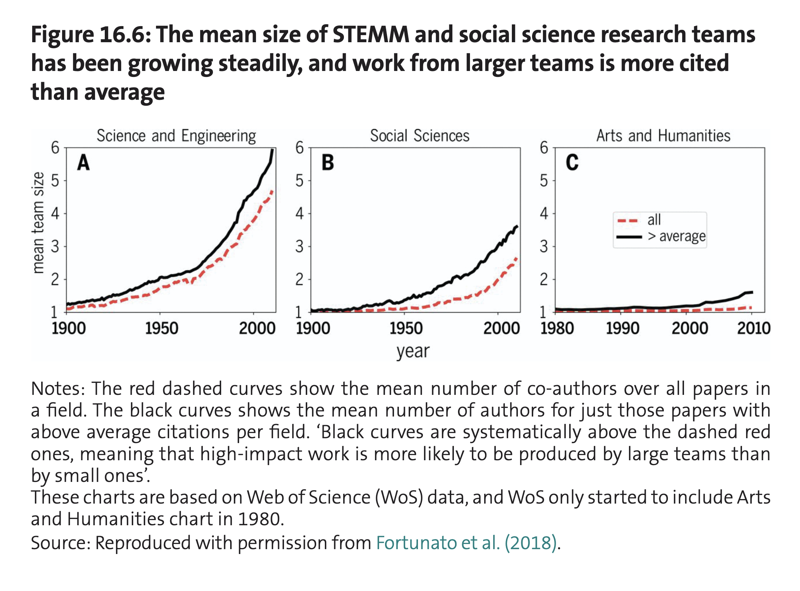

## Overview

- What is Open Science
- From Open Science to Open Research
- Doing Open Research
- Q&A

## About me

- Assistant Professor at the Centre for Interdisciplinary Methodologies - University of Warwick.
- Previously, in Geography at UCL and Oxford and Open Social Science Researcher at the LSE
- PhD in Sociology
- Interested in how we do research, innovative methods, computational methods (but not particularly quantitative methods!), infrastructure and how knowledge is produced.

## Why this talk?

::: columns
::: {.column width="40%"}

:::
::: {.column width="40%"}
[https://press.lse.ac.uk/books/m/10.31389/lsepress.dos](https://press.lse.ac.uk/books/m/10.31389/lsepress.dos)

:::
:::

## Co-Author: Patrick Dunleavy

::: columns
::: {.column width="40%"}

:::
::: {.column width="60%"}
- Emeritus Professor of Political Science and Public Policy
- Fellow of the British Academy
- Authoring a PhD: How to Plan, Draft, Write and Finish a Doctoral Thesis or Dissertation
  - Make sure to read this!
:::
:::

## Book structure

4 sections, 16 chapters (two additional chapter co-authors)

1) Opening up the Social Sciences
2) Practical approaches to more open research
3) Achieving more open qualitative research
4) Shifting research cultures

# What is Open Science?

## What is Science?

- 'Science' has to some extent always been open;
  - Cumulative advancement of knowledge
  - Testing and reproducibility of results
  - Publication and dissemination of findings
- Are ideals that distinguish the emergence of 'science' as a unique formation during the enlightenment
- See *'Republic of Letters'*

## Formation of 'modern' Science {.smaller}

- From the late 19th century these value crystallised into a form that remains recognisable today;
  - Institutionally defined disciplinary boundaries
  - Open debate amongst 'equal' colleagues within disciplines
  - Transparent publication of results and methods of investigation
  - Publication in peer-reviewed journals or scholarly presses

- Separation of 'science' (broadly defined) from 'non-science'

::: {.notes}
- Note many of these advances are often (by non-specialists) are assumed to have developed first in the natural sciences and spread to the social sciences, arts and humanities, when in fact, often these models were first pioneered and refined by humanities disciplines such as, law, archaeology or philology - particularly in German research universities - before spreading to their 'harder science' cousinsq
:::

## 'Closure' of 21st century science {.smaller}

- Increasingly difficult for non-professional (and many professional) scientists to access and assess fields due to rises in;
  - Complexity, mathematization, and highly discipline specific language
  - Commercialisation resulting in 'closed' and 'private' labs
  - 'Salami Slicing' of results resulting in information overwhelm
  - Publication costs and fees for subscription journals and specialist books
- Resulting in access to science being increasingly limited to those with institutional backing
  - (including many scientists and scholars outside of big, western, 'research intensive' universities)

## Drive to Open Science

- Long running tensions within scientific practice came to the fore in the late 20th century, coalescing into a broad movement that came to be known as 'Open Science'
  - Concern over quality and 'safety' of scientific results
  - Gate-keeping and contests for resources
  - Declining public trust
  - Practical impediments to working scientist

## Defining Open Science

- Not one unified ideology, but a broad 'umbrella' of agendas [@fecher2013open]
  - Public School
  - Democratic School
  - Pragmatic School
  - Infrastructure School
  - Measurement School

::: {.notes}
The infrastructure school (which is concerned with the technological architecture), the public school (which is concerned with the accessibility of knowledge creation), the measurement school (which is concerned with alternative impact measurement), the democratic school (which is concerned with access to knowledge) and the pragmatic school (which is concerned with collaborative research).
:::

## Defining Open Science

::: {.custom-small}
| School of thought | Central assumption                                                        | Involved groups                   | Central Aim                                                             | Tools & Methods                                                 |
| ----------------- | ------------------------------------------------------------------------- | --------------------------------- | ----------------------------------------------------------------------- | --------------------------------------------------------------- |
| Democratic        | The access to knowledge is unequally distributed.                         | Scientists; politicians; citizens | Making knowledge freely available for everyone.                         | Open Access; intellectual property rights; Open data; Open code |
| Pragmatic         | Knowledge-creation could be more efficient if scientists worked together. | Scientists                        | Opening up the process of knowledge creation.                           | Wisdom of the crowds; network effects; Open Data; Open Code     |
| Infrastructure    | Efficient research depends on the available tools and applications.       | Scientists & platform providers   | Creating openly available platforms; tools and services for scientists. | Collaboration platforms and tools                               |
| Public            | Science needs to be made accessible to the public.                        | Scientists & citizens             | Making science accessible for citizens.                                 | Citizen Science; Science PR; Science Blogging                   |
| Measurement       | Scientific contributions today need alternative impact measurements.      | Scientists & politicians          | Developing an alternative metric system for scientific impact.          | Altmetrics; peer review; citation; impact factors               |

[@fecher2013open]

:::

## Open Science & the Digital {.smaller}

- The digital revolution has been fundamental in the creative impetus behind and practical operationalization of Open Science

    - For example the creation of the arXiv pre-print server in 1991 (before the modern web!)

    - Allowed physicists to at no/low cost to instantly share results;

    > *"It is hard to imagine now, but considerable time and effort was once spent printing, photocopying and posting preprints to a privileged few friends and colleagues, before publication in formal journals"* 

[@ginsparg2011]

- In part these developments prompted a wider cultural re-evaluation of what and how to publish

## Free and Open Source Software {.smaller}

- Origins in 1980s *hacker* culture reacting against the corporatization and commercialisation of computing
- The four freedoms of *free software*;
  - Freedom to use the programme for any purpose; 
  - Freedom to study the programme and modify it to adapt it to your needs;
  - Freedom to freely distribute copies of the programme;
  - Freedom to improve the programme and to publicly distribute the improvements, so that the whole community could benefit.
  - [See: @manzo2020economy]
- *‘Open Source’* term was coined in 1990s to rebrand towards a development style that was more able to work more easily with commercial interests

## Free vs Open Source vs Free to Use {.custom-small}

|  | Costs (For users) | Code | Restrictions | Motivating Philosophy  |
|---|---|---|---|---|
| Free software | Free to use | Accessible and modifiable | No restrictions on use, derivatives may not be relicensed or made proprietary | Openness is best for software development. As a political principle all software should be free and open |
| Open Source | Free to use | Accessible and modifiable | No restrictions on use, derivatives may be relicensed or made proprietary | Openness is best for software development, often supported by corporate developers |
| ‘Free’ platforms | Free for end-users | No access | Use at the discretion of the owner, no modifications | Users fund the platform company’s business model (via advertising, data capture, future fees)  |
| Paywall proprietary software | Paid | No access | Only usable with a paid licence, no modifications allowed | Costs of software drive the provider’s business model |

## What is Open Science

- A Movement of reform focused on;

  - Improving research practices
  - Transparency in methods and data
  - Equity in access to knowledge
  - Sustainability of scientific infrastructure

- These are disparate and sometimes contradictory aims
- Different disciplines, methodological and epistemic traditions have their own understanding and implementation of these aims
  - As do individual scientists!

# From Open Science to Open Research

## Open (Social) Sciences

- We argue that open science practices from the 'hard' STEM sciences cannot simply be read across or imported to social science contexts
- Each discipline must consider what 'openness' means in their own context
- Most importantly defining an Open Social Science must be **researcher led** and focused on what works to further their research

## Open Research {.smaller}

- I believe the same is true for all researchers regardless of disciplinary background

- Open research should be a question of;

  - How does help my research practices
  - How can it enhance the quality of my work
  - Strengthen the research culture of my discipline
  - Enhance the dissemination and comprehension of knowledge

- This is to think about research across the life cycle from inception to publication and beyond

- Open research is not an end goal, but a process and a practice to be defined and refined

::: {.notes}
- *Social scientists will need to autonomously adopt ‘open’ practices for their own, good reasons – because open works better to get research done, explained, accepted, reused and acted on. But what open means for social science research (and cognate areas of the humanities) has yet to be fully settled. So it is up to researchers to figure out and create OSS across many diverse sub-fields, and to evaluate how it can better further their research. [...] Embracing OSS is not just about learning how to do specific things differently or acquiring a small number of discrete new skills or technology competencies. It is instead about making a far-reaching change in academic culture, one that is distinctively modern*

- There is alot of overlap between open social science, open research, and the **Digital Humanities**
:::

## 4 Rs

# Doing Open Research

# Research as everyday practice

## Documenting Research as you go

- How to organise the practice of research so that it works best for *you*
- There is no correct way in which this can be done - it is unique to each researcher
- Discoverability, interoperability and efficiency are of the upmost importance

::: {.notes}
- Change to next side for updated title!
:::

## Or openness as the boring, mundane and practical work of research

- How to organise the practice of research so that it works best for *you*
- There is no correct way in which this can be done - it is unique to each researcher
- Discoverability, interoperability and efficiency are of the upmost importance

## What does a more open research look like in my *research* practice {.smaller}

- Thinking through what you are doing as part of your day to day practice of being a researcher
- Ask yourself these questions;
  - How will you be able to access your research, notes, data and files in the future?
  - Do you need to pay/have an institutional affiliation to access and use these resources?
  - Will you (or someone else) be able to understand what you have done in 1, 5, 10 years from now when the research is no longer fresh in your mind?
  - Can your rely on the software or tools you are using for long term support?

## Building your own research archive

- In order to answer these questions you need to think about your own research practices as an archive
- If your archive is navigable, orderly and consistent it will benefit you throughout your career!
- You can choose to open up your archive as and when you choose

::: {.notes}
Use the workshop example;
For example, picture a messy workshop with multiple ongoing pieces of work. Around the workshop are strewn various tools, nuts and bolts, instructions manuals in an apparently chaotic fashion. For a skilled artisan in their own workshop everything may nonetheless have a purpose and a place. Yet others cannot understand the organization as it exists in the artisan’s mind, making the workshop difficult for even skilled people to use and an inscrutable environment unsuitable for teaching new skills. Now imagine a workshop that has a clear system of organization, where similar tools and parts are sorted into containers organized into logical groupings in transparent containers – so that anyone new to the workshop can see what is inside each box and how many parts are available. The workshop still reflects the idiosyncrasies and priorities of the skilled artisan in control. For instance, regularly used tools are kept close at hand, several different projects are ongoing on different workbenches, and how they wish to organize the space may still be unique. A good research workflow should mimic this image, reflecting the needs and sensibilities of the researcher(s) and their work, while at the same time being legible and transparent in ways that help explain what was done, fully establish the provenance of evidence, and share research methods and findings with others.
:::

## Tips for building your research archive

- Minimise friction
- More comprehensive or more technical **does not equally** better
- You will not be able to remember everything you have done in the future!

## Scratch pads

- This can be a notebook, post-it-notes, text document etc
- Use it to take notes, we all need to do this all the time
- Ask yourself if I lost this or it was destroyed, would this negatively affect my research?
- If so, then these notes need to be moved to somewhere that is safe and can be kept backed up!

## Back up your work! {.smaller}

- This is now a trivial task with the right software e.g. OneDrive, Dropbox (Proprietary), NextCloud, OwnCloud (Open Source)
- However! Consider;
  - Losing access to accounts
  - Multiple backups
  - Splitting out
    - 'Sensitive data' held on University accounts as per DMP etc
    - Personal research data, notes, article drafts, PDFs, on storage you control
- Think about how you are naming and organising files

## Keep a 'research log'

- This can be as simple as big 'research diary' file
- Include dates or other information that makes it easy for you to search
- Keep track of what you are doing and why, along with any comments or thoughts you have along the way

::: {.notes}
- A straightforward log file, where you keep simple bullet point descriptions of work done and decisions made, is an easy way to your research process. Including dates, file names and other findable or retrievable information makes your log file easily searchable, especially revisiting to look up otherwise potentially elusive information.

- An individual researcher working in an archive could make hand- written notes when there, of just the reference numbers of folders and files, then photograph these notes pages, and store them in folders organized by date on a PC, along with a few ‘reminder’ keys or tags to assist later recall. They also could maintain a separate Word document with a log of archive reference codes examined each day. Finding their thoughts on a specific box at the archive years later would then be a relatively straightforward process of opening up the log file, searching for the archive code and the folder of that day, and finding the relevant pages of notes. By contrast a more ‘per- fect’ digitization system, which required all notes to be typed up, imported to qualitative research software and then correctly tagged by topic and content, may seem ideal – but not if it breaks down or becomes erratic because of all the extra work required by the documentation process itself.

:::

## Use Zotero

## Use Zotero

- You may also be interested in [Tropy](https://tropy.org/)

# Open Research Methods

## Reusing data and mashing other people's data

- How can you make use of already open datasets?
- Making better use of existing datasets across research can help:
  - Strengthen generalizability
  - Enable methodological innovation and reassessment
  - Facilitate the efficient use of resources (*including researchers time!*)

## Open Data for replication archives and data annexes

- Making data open can be a publication in its own right!
- Supplementary materials for publications can extend their reach and relevance
- Cumulative benefits across all research for work that otherwise remains 'hidden'

## Interviews

- Inherently non-reproducible, but can be made more open 
- Where appropriate:
  - Deeper contextualisation and presentation of data
  - Development of 'quantitative' overviews to supplement qualitative analysis
  - Movement towards 'on the record' data
- Challenging in-person one hour, recorded and transcribed, anonymised, and 'privately' held interview as the *default* gold standard

## Case studies and Fieldwork

- Greater specification of cases, RQ and pre-registration to aide in openness
- Development of supplementary data and resources as part of case selection
- Methods for case interaction and mixed methods design
- Utility of systematic review and meta-analysis for socials scientific research

::: {.notes}
- On case selection, discuss Monica Krause's work on model cases which become privileged and can be 're-studied' over and over again as model cases in SS
- Mixed methods can be used in case selection
- Fuzzy set case selection
:::

## Systematic Documentation Analysis

- Potentially the most open already (but often not in practice!)
- Creation of document deposits and curation
- Mixed methods and quantitative approaches
- Resisting or subverting 'blackbox' stages of the process

::: {.notes}
- Remember the trend for people say this many google results for this topic or trend? How quaint an useless now! With what google has become, but also we have the tools and resources where the same purpose could be fully open and replicable (OpenAlex, CommonCrawl etc)
- 'Blackboxing' also risks becoming worse with AI
- Not necessarily reproducablity, but how replicability, robustnest and genralizability can be of use for other researchers
:::

## Archival Data

- Similar issues to documentation analysis, but with specificities to historical nature/institutional access
- Overlap with issues of historiography and digital humanities
- Bringing tacit knowledge into the open, e.g. academic blogging

## Citizen Open Research {.smaller}

- Perhaps the greatest area where Social Science research is already 'open' by default!

::: {.notes}
- 'social sciences numerous different theories and methods have also advocated opening up the research process to include those
being studied'
:::

## Citizen Open Research

Three areas there are helpful, strong synergies;

- Pre-planning thoroughly, which is also vital in any participatory project
- Recording fully what happens in inherently unrepeatable research events
- Maintaining clarity about what is included or excluded from the research

## Tensions in Citizen Open Research

However, three major tensions:

- Research boundaries and methods consistency under co-production
- Managing data release versus participants’ confidentiality
- Reconciling academic autonomy with authentic co-production

# Future Directions

## Openness as norm

- All UKRI publicly funded research is expected to be open-access in some form to be REF eligible
- Commitment to open practices (where appropriate) is an expectation of major funders
- Establishing and evidencing impact and reach is now widely expected

## Open Research as the future of Research

- Trends within research are clear;
  - Open research is cited more, and cited more diversely [@huang2024open]
  - Older research is being cited more (i.e. longer life to scholarly work) [@verstak2014shoulders]
  - Research is becoming more collaborative [@fortunato2018science]
  - More collaborative research (more authors) are cited more often [@fortunato2018science]

## Collaboration

## Shifting research cultures

- Barriers to greater 'openness' are cultural and institutional
- 'Digital decompression' is shifting the weight towards open research
- Methodological and interdisciplinary work is at the heart of defining open research practices
- **Open research practices must be defined by and benefit researchers themselves**

## Openness as opportunity

- Some of the most exciting arts and humanties work is now coming out of Open Access presses;
  - [Meson Press](meson.press/)
  - [Punctum Books](https://punctumbooks.com/)
  - [Mattering Press](https://punctumbooks.com/)
  - [White Horse Press](https://www.whpress.co.uk/)
  - and many more...

# Questions / Discussion

## References {style="font-size: 0.5em;"}

::: {#refs style="column-count: 2; column-gap: 2em;"}
:::
